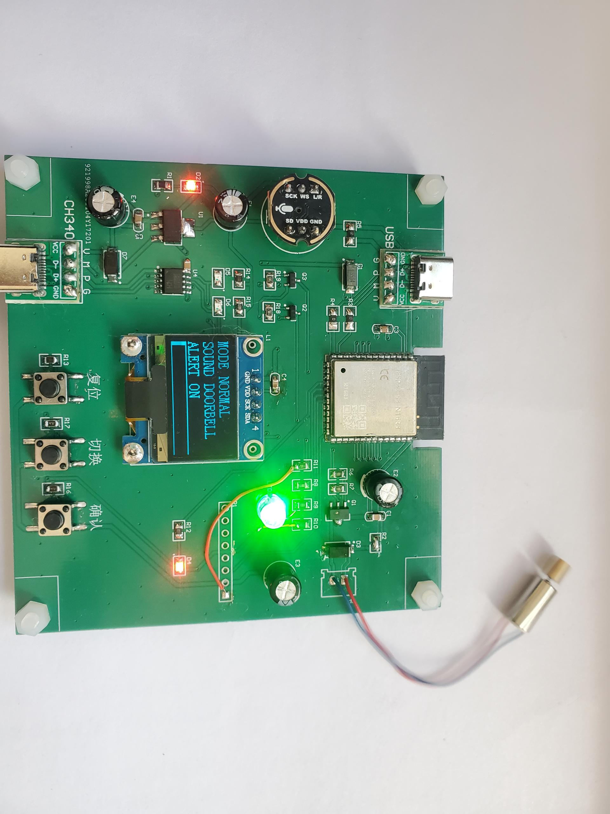
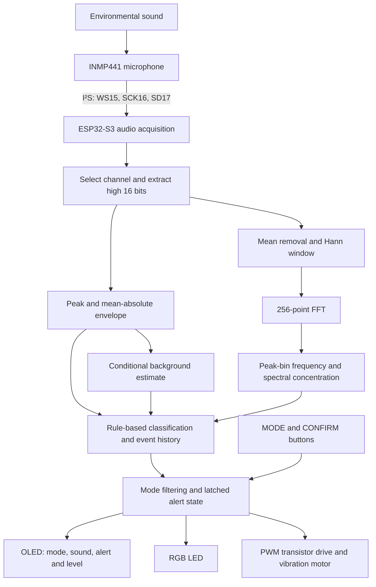
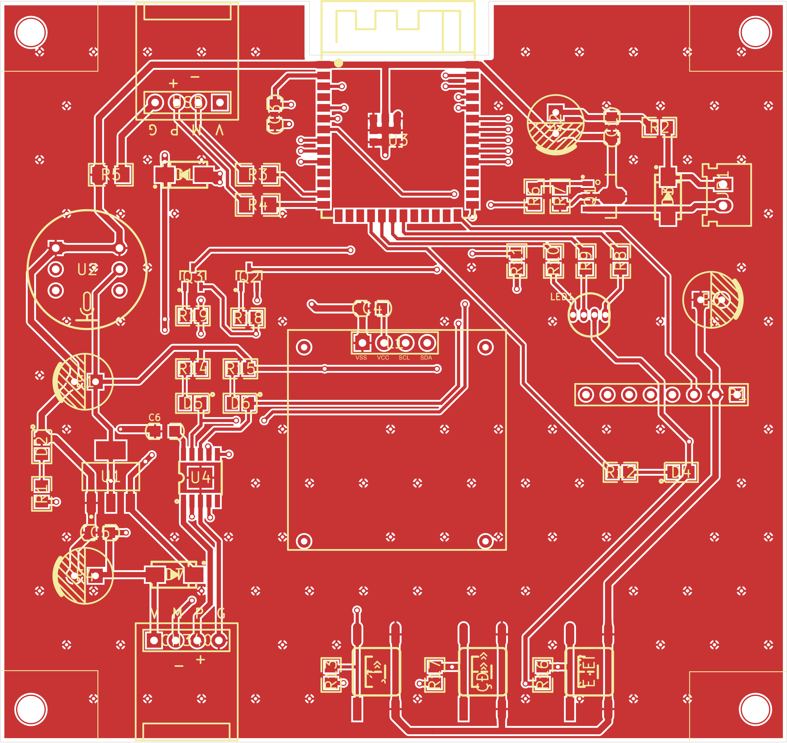
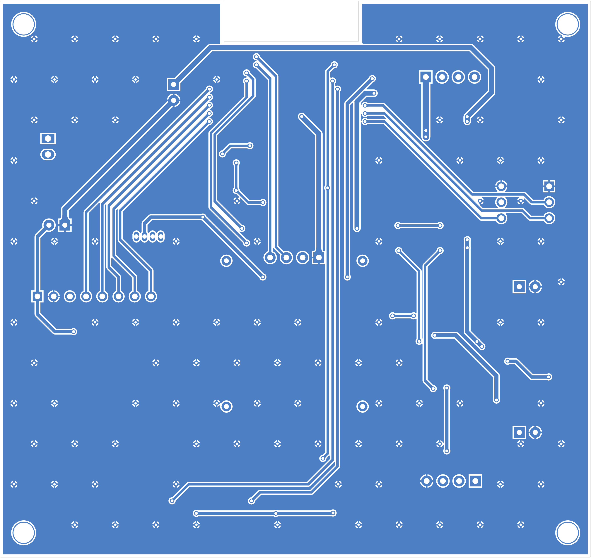
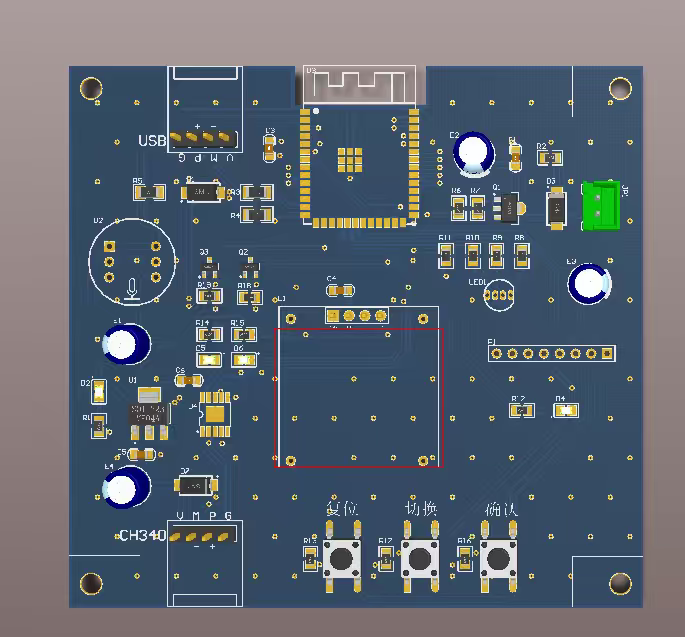
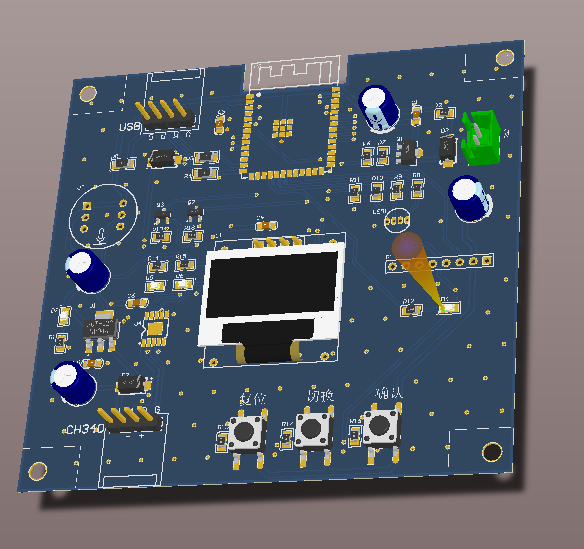
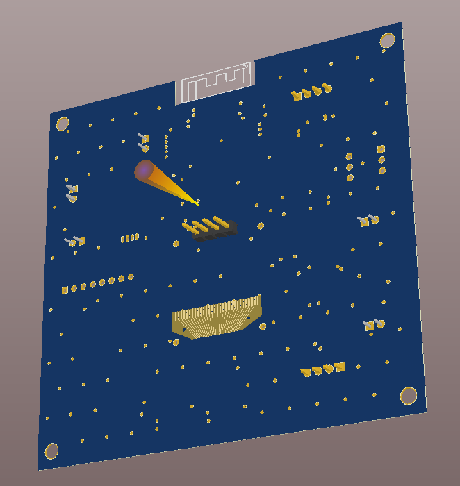
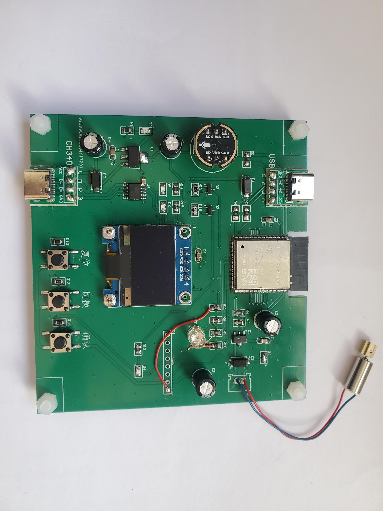
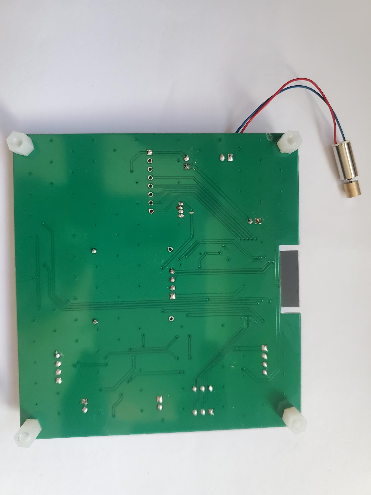
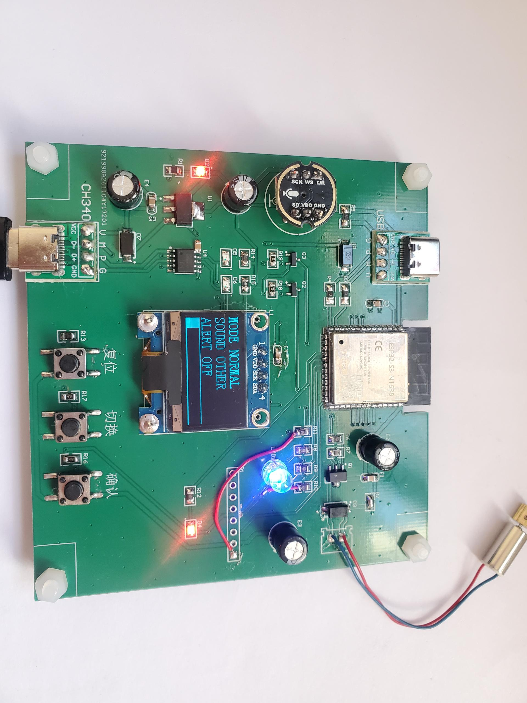

# SilentSignal — Embedded Acoustic Recognition System

SilentSignal is a standalone accessibility prototype that recognizes selected door knocks and doorbell sounds and converts them into visible and tactile alerts. An ESP32-S3 processes microphone audio locally, identifies acoustic patterns using rule-based digital signal processing, and controls an OLED, RGB LED and vibration motor. A smartphone application and internet connection are not required.

Everyday acoustic cues can be difficult to notice for people with hearing impairments. This project explores a dedicated hardware approach: capture the sound, identify a useful event, retain an alert, and let the user acknowledge it or select which target sounds should trigger notification.

**Prototype status:** the builder reports good overall recognition during personal testing. Supplied photographs show knock and doorbell display states with distinct LED colours. No quantitative trial records were supplied, so no measured accuracy, detection range or false-positive rate is claimed. Hardware discrepancies and publication review items remain documented below.

<p align="center"></p>

*Actual assembled prototype in a doorbell alert state. A still photograph establishes the visible state, not the triggering sound or tactile response.*

## Project guide

- [Design specifications](#design-specifications)
- [System architecture](#system-architecture)
- [Hardware and wiring](#hardware-and-wiring)
- [Engineering calculations](#engineering-calculations)
- [Schematic and PCB](#schematic-and-pcb)
- [Firmware and signal processing](#firmware-and-signal-processing)
- [Prototype operation](#prototype-operation)
- [Testing methodology and results](#testing-methodology-and-results)
- [Engineering findings and future work](#engineering-findings-and-future-work)
- [Running the project](#running-the-project)
- [Repository and publication status](#repository-and-publication-status)

## Design specifications

| Item | Verified implementation | Evidence / qualification |
| --- | --- | --- |
| Controller | ESP32-S3-WROOM-1 (N16R8) | BOM; ESP32-S3 target and 16 MB flash in supplied sdkconfig |
| Microphone | INMP441 module | BOM, schematic and MIC driver |
| Sampling | 16,000 samples/s; stereo 32-bit I²S slots | Driver config; higher-peak channel selected per frame |
| Audio frame / FFT | 256 samples per channel; 256-point FFT | 16 ms nominal acquisition interval |
| Preprocessing | High 16 bits of slot; mean removal; Hann window | MIC.c; amplitude statistics precede FFT preprocessing |
| Recognition | Time-envelope and spectral thresholds with multi-frame state | No trained neural network or model supplied |
| Display | 128 × 64; SSD1306-style driver; I²C address 0x3C | BOM names SSD1306/SSD1315; fitted controller not independently identified |
| Notifications | RGB LED, OLED status, motor PWM | Intended knock/red, bell/green, OTHER/blue mapping; LED polarity needs reconciliation |
| Motor drive | GPIO7, 1 kHz, 10-bit PWM; alert command 256 | 25% nominal duty; motor ratings and current unmeasured |
| Power | USB input paths; diode-fed rail labelled 4V; AMS1117 to 3V3 | Schematic intent, not measured rail regulation |
| Modes | NORMAL, KNOCK, DOORBELL | Short MODE press cycles modes |
| Controls | CONFIRM GPIO5; MODE GPIO6; board reset | Active-low inputs, release-based short presses |
| Language / framework | C, ESP-IDF, FreeRTOS | Archived build metadata identifies ESP-IDF v5.5.6; fresh build not performed |
| Design files | Altium Designer .PrjPcb, .SchDoc, .PcbDoc | Editable design copies; personal path metadata removed where present |

## System architecture



I²S supplies synchronized digital microphone samples using a serial clock and word-select signal. The ESP32-S3 calculates amplitude and spectral features, then evaluates knock and bell rules across recent frames. Mode filtering determines which target classes may latch an alert. An independent control task applies motor and LED commands, while the UI task updates status text. I²C suits the low-bandwidth OLED; this implementation generates its bus signals in software on two GPIOs.

## Hardware and wiring

The following rationale describes engineering suitability and trade-offs; the files do not document the original designer's historical selection process. See the [BOM](Hardware/BOM/bomfile.xls) and [readable BOM extract](Hardware/BOM/BOM_readable.md).

| Component | Role and supported details | Advantages and trade-offs |
| --- | --- | --- |
| ESP32-S3-WROOM-1 N16R8, U3 | Local acquisition, FFT, classification and UI | Separate tasks/cores support concurrent audio and interface work; radio capability is unused in this application |
| INMP441, U2 | Digital acoustic input; grounded L/R in schematic | Digital acquisition avoids an external analog ADC path; mounting and channel handling still influence signal quality |
| LCD12864 IIC, L1 | 128 × 64 OLED interface; BOM names SSD1306/SSD1315 | Direct mode/event feedback; small display and software-driven bus limit presentation and diagnostics |
| RGB-3528, LED1 | Three colour channels, 330 Ω series resistors shown | Distinct visual categories; actual LED polarity and photographed rework must match firmware |
| CH340K, U4 | USB-to-UART programming/debug path, separate from native USB | Offers serial access; adds components and another USB power path |
| AMS1117, U1 | Regulated rail labelled 3V3 | Simple linear supply architecture; dropout and heat depend on actual part, input voltage and load |
| S8050, Q1; JP1 | NPN motor switch and two-pin external motor connection | GPIO controls a separate load path; requires verified base drive, motor current, protection and supply headroom |
| S8050, Q2/Q3 | Boot/reset interface switching | Supports programming control; verify against fitted hardware and serial adapter behaviour |
| SW-PB4 ×3 | Reset, MODE and CONFIRM | Direct interaction; debounce and short-press interpretation affect operation |
| R8–R10: 330 Ω | RGB current limiting | Limits channel current; actual brightness depends on LED forward voltage and polarity |
| 1 kΩ / 10 kΩ / 0 Ω resistors | Indicators, base networks, pull-ups and links | Component values matter: motor-series R2 = 1 kΩ is an unresolved concern |
| C1/C3/C5/C6: 104; C4: 10 nF; E1–E4: 220 µF/16 V | Local and bulk capacitance | Supports supply decoupling; fitted capacitor chemistry, polarity and regulator stability require verification |
| D1/D3/D7 | Supply isolation and motor flyback path | BOM M7 / SS24 naming conflict prevents a confident part-specific voltage-drop calculation |
| External vibration motor | Tactile notification | Visible in prototype photos; absent exact part number, startup/stall current and rated voltage |

Manufacturer references: [ESP32-S3 datasheet](https://www.espressif.com/sites/default/files/documentation/esp32-s3_datasheet_en.pdf), [Espressif hardware checklist](https://docs.espressif.com/projects/esp-hardware-design-guidelines/en/latest/esp32s3/schematic-checklist.html), and [TDK INMP441 product information](https://product.tdk.com/en/search/sw_piezo/mic/mems-mic/info?part_no=INMP441). Confirm exact fitted regulator, diode, OLED and motor variants before applying part-specific ratings.

### GPIO and peripheral connections

| Function | ESP32 connection | Hardware / review note |
| --- | --- | --- |
| Microphone WS | GPIO15 | I²S word select |
| Microphone SCK | GPIO16 | I²S bit clock; no MCLK output |
| Microphone SD | GPIO17 | I²S input |
| Microphone supply / L/R | 3V3, GND; L/R to GND in schematic | Left channel selected physically; firmware reads both slots |
| OLED SCL / SDA | GPIO1 / GPIO2 | Actual macros and schematic agree; an old header comment says GPIO19/20 and is stale |
| OLED supply | 3V3 / GND shown | Driver emits address byte 0x78, equivalent to 7-bit 0x3C |
| RGB red / green / blue command | GPIO13 / GPIO12 / GPIO11 | Active-high firmware conflicts with common-anode schematic; verify assembled LED |
| Status LED | GPIO10 | Toggles every 50 control ticks; nominal 0.5 s between transitions |
| CONFIRM / MODE | GPIO5 / GPIO6 | Pull-ups enabled; buttons connect input to ground |
| Motor PWM | GPIO7 | Q1 base via R6; motor at JP1; R2 series supply path needs review |
| Native USB D− / D+ | GPIO19 / GPIO20 | Shown through 0 Ω links; distinct from OLED pins |
| Serial programming | TXD0 / RXD0 nets to CH340K | USB bridge is a separate connector/path; verify board port before flashing |
| Boot / reset | GPIO0 / EN | Pull-ups and auto-programming transistors in schematic |
| Power / ground | USB VCC to diode-fed rail, regulator to 3V3; shared GND | Do not infer measured 4.0 V from the rail name; R5 is shown in the USB ground return |

Native USB GPIO19/20 assignments are also documented by [Espressif](https://docs.espressif.com/projects/esp-hardware-design-guidelines/en/latest/esp32s3/schematic-checklist.html). Do not follow the stale OLED comment when wiring the board.

## Engineering calculations

These calculations were derived during documentation review from source constants and schematic values. They are neither historical development notes nor measured performance.

| Quantity | Equation and substitution | Result and significance |
| --- | --- | --- |
| Sample interval | T = 1 / fs = 1 / 16,000 s | 62.5 µs between samples per channel |
| Nyquist frequency | fN = fs / 2 = 16,000 / 2 | 8 kHz theoretical limit; not a verified microphone system bandwidth |
| Frame acquisition | Tf = N / fs = 256 / 16,000 s | 16 ms nominal audio duration; **not measured CPU processing time** |
| FFT spacing | Δf = fs / N = 16,000 / 256 | 62.5 Hz; reported source frequency currently uses integer 62 × bin |
| Bell history | 16 × Tf = 16 × 16 ms | 256 ms sliding history; 8 qualifying frames represent 128 ms of evidence and need not be consecutive |
| Startup warmup | 12 × 16 ms | 192 ms nominal; startup and partial reads affect wall time |
| Knock look-back | 5 × 16 ms | About 80 ms after the candidate frame; not full end-to-end latency |
| Knock cooldown | 10 × 16 ms | 160 ms nominal event suppression interval |
| OTHER colour hold | 125 × 16 ms | About 2 s of successful full-frame cadence; text is not automatically cleared |
| I²S payload rate | 16,000 × 2 slots × 32 bits | 1.024 Mbit/s, or 128,000 bytes/s before peripheral overhead |
| Motor duty | D = 256 / 2¹⁰ | 25% commanded duty; torque, speed and current do not scale exactly with this number |
| Main audio arrays | 3 × 256 × 4 + 512 × 4 + 2 × 256 × 2 bytes | 6,144 bytes for FFT arrays plus active read buffers; excludes history, DMA, stacks, heap and unused helper buffer |
| Requested task stacks | 4,096 + 3,072 + 4,096 bytes | 11,264 bytes requested by three task creations; not measured stack usage |
| RGB resistor current bound | I ≤ 3.3 V / 330 Ω | ≤10 mA ideal rail-based bound; actual current is (rail − LED Vf − driver drop)/R and must be measured |
| Motor-path current bound | I ≤ 4 V / 1,000 Ω, assuming nominal schematic rail and fitted R2 | ≤4 mA before other drops; motivates inspection of actual rework rather than a claim of sufficient drive |

OLED refresh is requested every 100 ms and controls every 10 ms, plus execution and scheduling time. Recognition latency also depends on signal onset, frame alignment, history, acquisition, classifier state and output response. No latency guarantee follows from adding nominal task delays alone.

Regulator loss would be P ≈ (Vin − 3.3 V) × Iload, with quiescent loss added for a more complete estimate. Actual Vin, load current and fitted regulator data are missing, so a numeric thermal result is not justified. Motor current, overall power and runtime likewise remain unmeasured.

## Schematic and PCB

[](Screenshots/Schematic/Circuit_Schematic.png)

*Complete supplied schematic reference. This is a pre-existing KiCad working export of the Altium-origin design. The local file-path footer was removed from the upload PDF and its PNG was rendered again from that PDF. No circuit was imported, converted or redrawn during repository preparation.*

| Top layout | Bottom layout |
| --- | --- |
|  |  |

| Supplied front render | Supplied back render |
| --- | --- |
|  |  |

| Angled front | Angled back |
| --- | --- |
|  |  |

[Additional supplied 3D view](Screenshots/PCB_3D/PCB_3D_View.png). The renders are design views, not photographs of successive prototype revisions. Some models are absent from the views, so they do not establish an assembled bill of materials.

The layout places the ESP32 module and microphone toward the upper board area, the display centrally, and user buttons toward the lower edge in the supplied renders. USB access sits on opposite sides. The schematic separates power regulation, digital audio, indicators, motor switching and serial programming. Bulk and local capacitors appear around the supply circuitry. These observations do not certify return-path quality, decoupling performance, USB integrity, antenna clearance or manufacturing readiness.

Editable design files (personal path metadata sanitized in upload copies): [Altium project](Hardware/Altium/ESP32_Sound.PrjPcb), [schematic](Hardware/Altium/ESP32_Sound.SchDoc), [PCB](Hardware/Altium/ESP32_Sound.PcbDoc), [BOM](Hardware/BOM/bomfile.xls). No DRC/ERC sign-off or electrical validation report was found. The supplied import report describes conversion status only; it is not an electrical audit.

## Firmware and signal processing

The source uses three FreeRTOS tasks. `mic_task` runs on core 1 at priority 5, `ui_task` on core 0 at priority 4, and `ctrl_task` on core 0 at priority 6. Shared display/alert state is protected by a critical-section lock. This separation reduces direct interference between display updates and audio processing, but real-time deadlines and stack margins have not been measured.

The microphone driver reads 256 stereo sample pairs, selects the higher-peak channel and extracts peak and mean absolute amplitude. For full frames it removes the mean, applies a Hann window and computes an in-place radix-2 FFT. Spectral concentration uses the strongest bin plus its neighbours; the stored `f0_hz` is a peak-bin estimate, not necessarily a fundamental frequency.

The exact tonal-frame rule in [main.c](Firmware/main/main.c) is:

```c
return frame->peak >= gate_of(noise, 3, 450) &&
       frame->tone_x100 >= 70 &&
       frame->crest_x10 > 0 &&
       frame->crest_x10 <= 40 &&
       frame->f0_hz >= 350 &&
       frame->f0_hz <= 2800;
```

Doorbell recognition requires at least eight tonal frames in a sixteen-frame history, with at most 500 Hz spread among qualifying peak-bin estimates. Knocks require a strong, abrupt amplitude rise followed by decay, sufficient crest ratio, limited tonal concentration and a peak-bin estimate inside the knock range. A cooldown reduces repeat triggers. When a bell is active, knock evaluation is inhibited.

The background estimate updates gradually only for frames below twice its current value. This is conditional amplitude adaptation, not general noise cancellation. A sudden loud background can remain outside the update gate. The [testing and engineering analysis](Documentation/Testing_and_Engineering_Analysis.md) details all thresholds, temporal behaviour, false-positive mechanisms and edge cases.

Alerts latch until confirmation. Mode filtering turns a recognized but excluded target into OTHER. OTHER may update sound text while an older target alert remains active. Acknowledgment stops the motor command and clears the colour, but does not clear the last sound label. Firmware state must therefore be considered when scoring physical tests.

## Prototype operation

| Assembled front | Assembled back |
| --- | --- |
|  |  |

| Powered display | Knock alert |
| --- | --- |
|  |  |

| Doorbell alert | Blue indication |
| --- | --- |
|  |  |

These are supplied photographs of the assembled device, not a fabricated development timeline. The images show a wired external motor and LED rework. They do not prove vibration strength, button response, sound identity, or the exact deployed firmware revision.

1. Power the verified assembled prototype using its established supply arrangement. Initial firmware state is NORMAL with alerts off.
2. Use a short press and release of MODE (GPIO6) to cycle NORMAL → KNOCK → DOORBELL → NORMAL. A long hold is not the implemented mode-switch gesture.
3. NORMAL permits both target classes; restricted modes permit only the named target to start an alert.
4. Read the OLED sound label and alert state. Intended colours are red for knock, green for bell and temporary blue for OTHER, subject to actual LED wiring.
5. Press and release CONFIRM (GPIO5) to clear a latched alert. The last sound label may remain visible. Changing mode alone does not clear an alert.

### Functional demonstration

No video or audio recording was found in the supplied project tree. The photographs above are the available visual evidence; there are no fabricated thumbnails or placeholder links to nonexistent videos. [Demo notes](Demo/README.md) specify what to capture next: real source, device response, acknowledgment and mode filtering in one continuous view. A selected demonstration should be labelled functional evidence, not a statistically validated accuracy test.

## Testing methodology and results

The builder's qualitative assessment is positive: overall recognition was quite good for an initial prototype. Photographs support visible knock/red and doorbell/green alert states. The supplied evidence does not provide condition-specific outcomes or quantitative recognition results.

**The complete [Testing and Engineering Analysis](Documentation/Testing_and_Engineering_Analysis.md) contains 16 acoustic scenarios and 14 notification/control scenarios**, detailed expected behaviours, a repeatable procedure, evidence limits, engineering trade-offs and prioritized improvements. All proposed scenario outcomes are explicitly unmeasured.

| Test group | Planned variation | Expected behaviour / principal question |
| --- | --- | --- |
| Knock sensitivity | Light, ordinary and firm; proposed 0.5–3 m positions; different doors | Recognize transient envelope; determine where amplitude gates or reverberation cause misses |
| Bell diversity | Sustained, two-tone, melodic, mechanical and short-pulse bells | Recognize enough stable tonal frames; expose out-of-band and changing-pitch limitations |
| Environmental conditions | Quiet, fan noise, speech, abrupt background changes | Retain useful target sensitivity without background-triggered alerts |
| Hard negatives | Footsteps, object drops, table taps, television and phone tones | Measure confusion with impact and tonal rules; distinguish OTHER from target false alerts |
| Output behaviour | OLED, each LED colour, actual vibration and persistence | Verify physical response separately from classifier output and GPIO commands |
| User controls | All modes, acknowledgment, held buttons and ongoing sounds | Confirm intentional mode rejection, latch clearing, rearming and state transitions |

The proposed procedure controls placement, source, intensity, background, mode and firmware revision; randomizes repeated trials; and records fresh events after rearming. Background-only exposure is timed separately. The target observation window is fixed before each scenario, and playback results are separated from real-world sources.

- [Empty CSV trial template](Results/test_results_template.csv): no fabricated observations.
- [Results recording guide](Results/README.md): field definitions and scoring rules.
- [Python analysis script](Results/analyze_results.py): confusion matrix, class precision/recall, missed labels, alert-policy errors and background false alerts/hour; no third-party packages required.

## Engineering findings and future work

The implementation combines interpretable local DSP, multi-frame evidence and persistent alerts. The main recognition trade-off is specificity versus sensitivity: stricter gates suppress interference but can miss weak or distant targets. Footsteps and dropped objects can share knock-like envelopes; stable beeps and voiced sounds can share bell-like spectral features. These are source-based explanations to test, not recorded false-positive findings.

The next engineering priorities are to reconcile LED polarity and motor wiring with the photographed assembly; record the deployed firmware revision; instrument features and fresh event timestamps; and collect repeatable real-source trials with hard negatives. Fixing integer frequency arithmetic, explicitly handling partial frames and improving gated noise adaptation should be evaluated on identical held-out data. Motor feedback and ambiguous persistent UI state deserve separate tests.

Longer-term work includes an enclosure with a deliberate microphone port and tactile coupling, measured power optimization, a diverse labelled dataset and a TinyML comparison against the existing rule-based baseline. Wireless notifications are a possible extension, not a current feature. See the [full discussion](Documentation/Testing_and_Engineering_Analysis.md) for trade-offs and evidence required to claim improvement.

## Running the project

These instructions are checked against source structure and official ESP-IDF documentation, but **a fresh build, flash and hardware run were not performed during preparation**. No software was installed and no device was flashed.

1. Use an existing ESP-IDF installation and its VS Code extension or ESP-IDF-enabled terminal. Archived metadata identifies v5.5.6; verify that toolchain version locally rather than assuming arbitrary versions are interchangeable. Follow the [official ESP-IDF Windows setup guide](https://docs.espressif.com/projects/esp-idf/en/v5.5/esp32s3/get-started/windows-setup.html) when preparing your own environment.
2. Open the `Firmware` directory as the project root in VS Code. It contains the top-level CMake project, `main`, `components` and `sdkconfig`. Select the ESP32-S3 target and the matching ESP-IDF environment. The retained configuration already targets ESP32-S3 with 16 MB flash.
3. In an ESP-IDF-enabled terminal, from `Firmware`, check and build:

```powershell
idf.py --version
idf.py build
```

4. Inspect any compiler output. In particular, the original components CMake file contains `-Wno-error=format=-Wno-format`, an unusual combined warning option that may need correction after reproducing the build failure. It has been preserved, not silently fixed. Existing build artifacts are not proof the current copied source builds cleanly.
5. After verifying the assembled hardware and choosing its serial port, the operator can flash and monitor with the following command, replacing `COM_PORT` with the actual port:

```powershell
idf.py -p COM_PORT flash monitor
```

6. Use Ctrl+] to exit the monitor. If automatic bootloader entry fails, inspect the actual CH340/reset/boot circuit and board procedure; do not assume an undocumented button sequence.
7. For hardware review, open `Hardware/Altium/ESP32_Sound.PrjPcb` in an existing Altium Designer installation and select the schematic/PCB documents in the project panel. Check external library/model dependencies and rule checks before relying on the design for manufacturing. No conversion is needed to view the supplied PNGs.

To summarize future manually collected records, from the repository root:

```powershell
python Results/analyze_results.py Results/test_results_template.csv
```

The empty template produces a no-data summary, not zero-percent performance. Save real observations in a new CSV and pass that filename to the script.

## Repository and publication status

| Directory | Contents |
| --- | --- |
| `Hardware/Altium` | Editable design copies with personal path metadata sanitized; local originals preserved |
| `Hardware/BOM` | BOM with creator metadata removed and readable extraction; `.xls` is internally an OOXML ZIP workbook |
| `Firmware` | C source, CMake files and sdkconfig; generated builds and machine-specific editor files excluded |
| `Screenshots` | Supplied schematic, PCB layouts and 3D renders |
| `Photos` | Supplied assembled-device photographs with descriptive filenames |
| `Demo`, `Datasets` | Availability notes; no invented media or data |
| `Results` | Empty recording template and analysis utility |
| `Documentation` | Detailed testing analysis, upload manifest, review checklist and privacy/attribution notes |

**Private GitHub review only. Public release is not authorized.** The [publication-readiness checklist](Documentation/Publication_Readiness.md) records open hardware, measurement, privacy and attribution items. No project-wide license has been assigned: ownership and redistribution permission for code, fonts, component libraries, design files and photographs need confirmation first.

This repository is intended for review directly on GitHub. Local HTML previews and preview-generation files are excluded. GitHub renders the Mermaid architecture block; the Markdown is the authoritative repository document.

Presentation references: [5V DC–DC Buck Converter](https://github.com/morganwang7777-ux/5V-DC-DC-Buck-Converter) and [ESP32 Wireless Telemetry](https://github.com/morganwang7777-ux/ESP32-Wireless-Telemetry). Their separation of engineering evidence, calculations, photographs and limitations informed the organization; SilentSignal's technical content comes from its own files and the builder's report.
