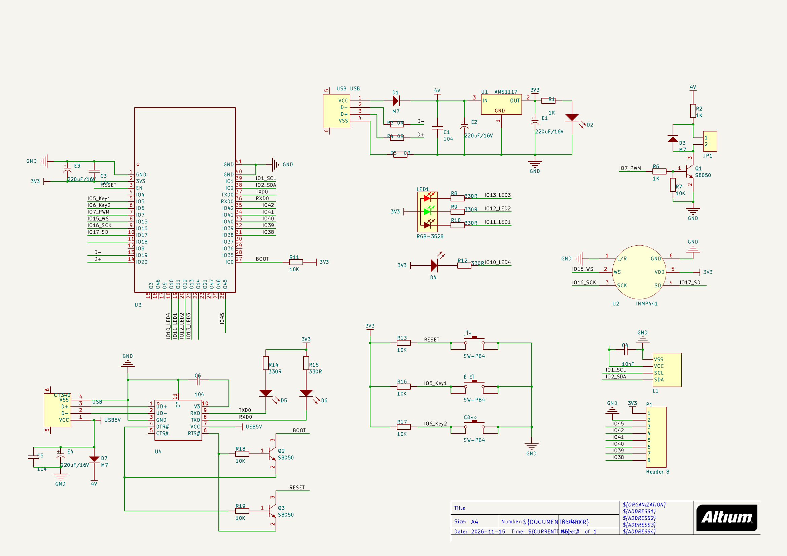
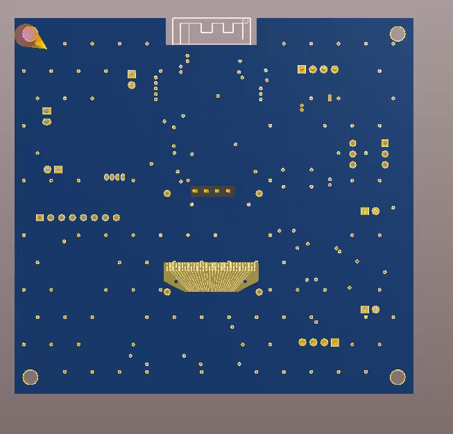
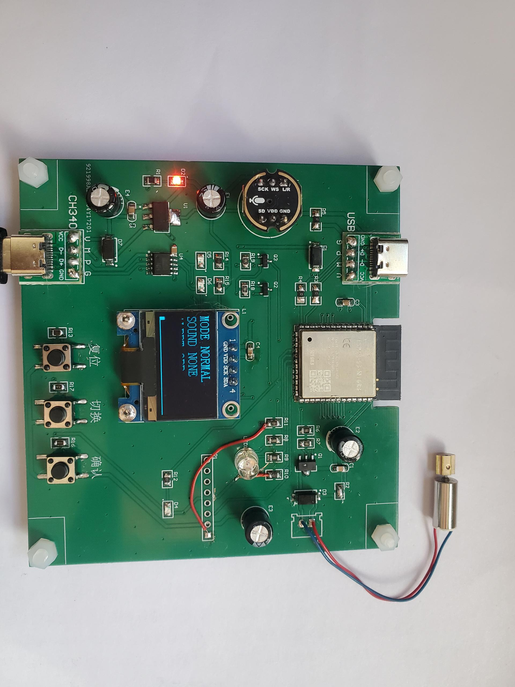
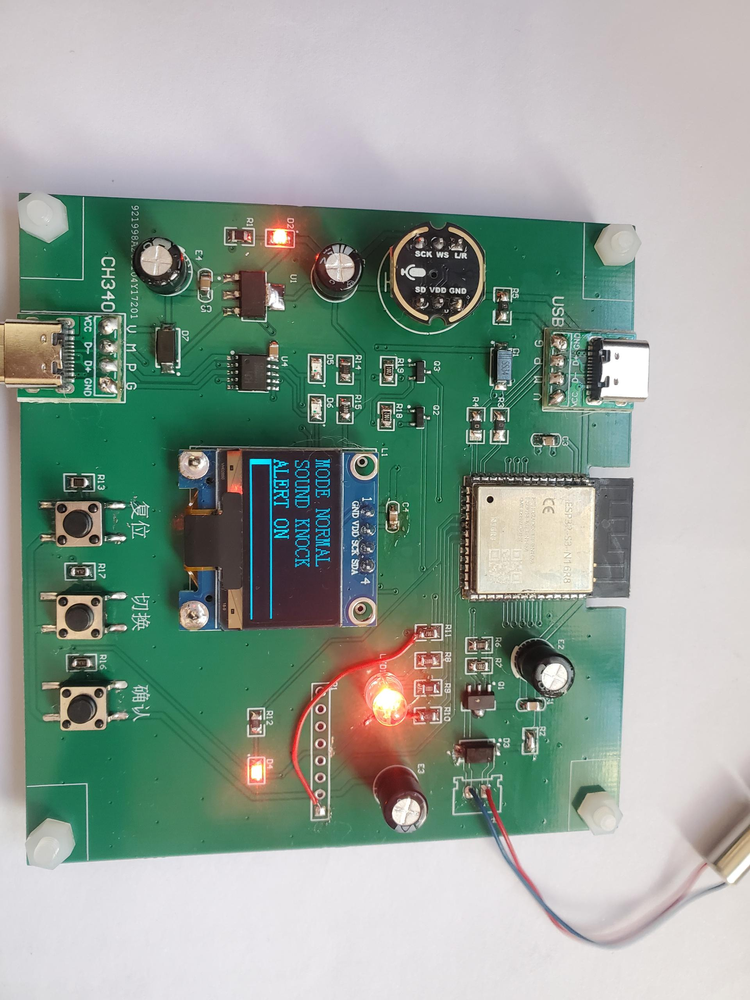
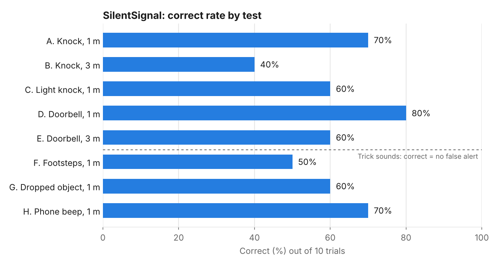
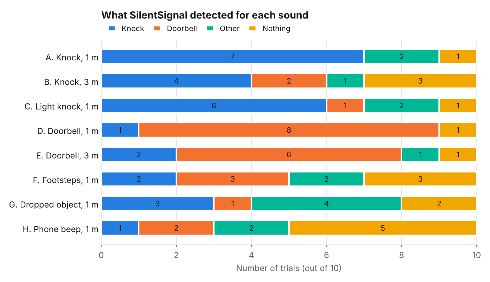

# SilentSignal

A small device that listens for door knocks and doorbells and turns them into a light, an on-screen message and a vibration. An ESP32-S3 on a custom PCB processes the microphone audio itself, with no phone app and no internet connection.

<p align="center"></p>

## Why I built this

<!-- TODO: rewrite this section in your own words. What made you want to build it? Who did you have in mind? What did you want to learn? -->

People who are deaf or hard of hearing can easily miss someone at the door, because knocks and doorbells are only sound. Most existing solutions need a smart doorbell, a phone app or a Wi-Fi connection. I wanted to see if one small board could do it on its own: hear the sound, work out what it is, and give an alert you can see and feel.

The questions I wanted to answer:

1. Can a cheap microcontroller tell a knock apart from a doorbell using simple signal processing instead of machine learning?
2. Can I design and build my own PCB for it, not just a breadboard?
3. What actually makes sound recognition hard in a real room?

## What I did

- **Designed a custom PCB** in Altium: ESP32-S3 module, INMP441 digital microphone, OLED, RGB LED, vibration motor driver, buttons, USB-to-serial and a 3.3 V regulator.
- **Wrote the firmware** in C with ESP-IDF and FreeRTOS, using three tasks: one for audio, one for the display and one for the LED and motor.
- **Built a sound classifier from scratch:** a 256-point FFT plus rules on loudness and pitch over several frames. No neural network.
- **Added modes and controls:** NORMAL alerts on both sounds, KNOCK or DOORBELL alert on only one, and a CONFIRM button clears the alert.
- **Assembled and tested the board,** then fixed the LED and motor wiring by hand (visible in the photos).

## How it works

```
[Sound] --> [INMP441 mic] --I2S--> [ESP32-S3: FFT + rules] --> [Alert state]
                                                                     |
                     [MODE / CONFIRM buttons] ------------------------+
                                                                     |
                               [OLED text] <-- [RGB LED] <-- [Vibration motor]
```

1. The microphone sends audio to the ESP32-S3 at 16,000 samples per second.
2. Every 256 samples (16 ms), the firmware measures how loud the frame is and runs an FFT to find the strongest frequency.
3. **Knock:** a sudden loud spike that dies away quickly and isn't a clean tone.
4. **Doorbell:** at least 8 of the last 16 frames are a steady tone between 350 and 2,800 Hz.
5. If the current mode allows it, the alert latches: red for a knock, green for a doorbell, plus the motor and an OLED message. Other sounds flash blue briefly.
6. The alert stays on until you press CONFIRM.

Thresholds, timing and the full classifier logic are in the [design notes](docs/design-notes.md#firmware-and-signal-processing).

## Hardware

| Part | Use |
|---|---|
| ESP32-S3-WROOM-1 (N16R8) | runs the audio processing, classifier and UI |
| INMP441 MEMS microphone (I2S) | digital audio input |
| 0.96" 128×64 OLED (I2C, 0x3C) | shows mode, detected sound and alert status |
| RGB LED (3528) | red = knock, green = doorbell, blue = other sound |
| Vibration motor + S8050 transistor | tactile alert, driven by PWM |
| CH340K | USB-to-serial for flashing and debugging |
| AMS1117 regulator | 3.3 V supply |
| 3 push buttons | reset, MODE, CONFIRM |

Full parts list: [BOM](hardware/bom/BOM_readable.md).

### Wiring

| Function | ESP32-S3 pin |
|---|---|
| Mic WS / SCK / SD | GPIO 15 / 16 / 17 |
| OLED SCL / SDA | GPIO 1 / 2 |
| RGB LED red / green / blue | GPIO 13 / 12 / 11 |
| Status LED | GPIO 10 |
| CONFIRM / MODE buttons | GPIO 5 / 6 (active low, internal pull-ups) |
| Motor PWM | GPIO 7 |

## PCB

| Schematic | Top layout |
|---|---|
| [](screenshots/schematic/Circuit_Schematic.png) |  |

| 3D render, front | 3D render, back |
|---|---|
|  |  |

Altium files: [project](hardware/altium/ESP32_Sound.PrjPcb), [schematic](hardware/altium/ESP32_Sound.SchDoc), [PCB](hardware/altium/ESP32_Sound.PcbDoc). More views are in [`screenshots/`](screenshots/).

## The finished board

| | |
|---|---|
|  |  |
| Assembled front, with the hand-wired LED fix | Back, with the vibration motor on wires |
|  |  |
| Powered on: NORMAL mode, no sound | Knock detected: red alert |
|  |  |
| Doorbell detected: green alert | Other sound: blue, no alert |

<!-- TODO: if you have photos from earlier (breadboard prototype, bare PCB, soldering), add a "Build progress" section like this with numbered photos. -->

## Testing

**Setup:** NORMAL mode, indoors, with the device on a table and the microphone facing the sound. I ran 8 tests with 10 trials each (80 trials in total). After each sound I waited 3 seconds, recorded whether the LED showed knock (red), doorbell (green), other (blue) or nothing, then pressed CONFIRM.

- **Target sounds** (A–E): correct means the right alert.
- **Trick sounds** (F–H): correct means no knock or doorbell alert (blue or nothing).

### Results

| Test | Knock | Doorbell | Other | Nothing | Correct |
|---|---|---|---|---|---|
| A. Knock, 1 m | **7** | 0 | 2 | 1 | 70% |
| B. Knock, 3 m | **4** | 2 | 1 | 3 | 40% |
| C. Light knock, 1 m | **6** | 1 | 2 | 1 | 60% |
| D. Doorbell, 1 m | 1 | **8** | 0 | 1 | 80% |
| E. Doorbell, 3 m | 2 | **6** | 1 | 1 | 60% |
| F. Footsteps, 1 m | 2 | 3 | 2 | 3 | 50% |
| G. Dropped object, 1 m | 3 | 1 | 4 | 2 | 60% |
| H. Phone beep, 1 m | 1 | 2 | 2 | 5 | 70% |
| **Total** | | | | | **49 / 80 (61%)** |





### What I found

- **Distance matters a lot.** Knock detection dropped from 70% at 1 m to 40% at 3 m, and doorbells dropped from 80% to 60%. At 3 m, 3 of 10 knocks didn't trigger anything at all, so the loudness threshold is probably too strict for quieter, more distant sounds.
- **Doorbells were easier to recognize than knocks** at both distances. The doorbell rule looks for a steady tone across several frames, which gives it more evidence to work with. A knock is one short, sharp sound, and it varies a lot with how hard you knock and what the door is made of.
- **Trick sounds caused false alerts in 12 of 30 trials.** Dropped objects were mistaken for knocks 3 times, because both are sudden impacts. Footsteps were mistaken for a doorbell 3 times, which I didn't expect. Footsteps shouldn't sound like a steady tone, so this is the first thing I want to investigate.
- **Knocks and doorbells sometimes got mixed up:** 6 of the 50 target trials got the wrong alert.
- **For an elderly user, a missed knock is worse than a false alert,** so the next version should focus first on detecting knocks from farther away.

The raw counts are in [`results/test_results.csv`](results/test_results.csv), and [`results/plot_results.py`](results/plot_results.py) makes the graphs.

## Issues I found in my own design

Reviewing the board after building it, I found a few things to fix in the next revision:

- **LED polarity mismatch.** The schematic uses a common-anode RGB LED, but the firmware drives it as active-high. I fixed it with rework wires on this board (the red wires on the front).
- **Motor drive resistor.** The motor supply path goes through a 1 kΩ resistor (R2), which limits the current to only a few mA in theory. The motor is also hand-wired on this board. Both need to be fixed properly on the next PCB.
- **Diode part number conflict.** The BOM lists the diodes as both M7 and SS24, which are very different parts.
- **Frequency estimate is rough.** The FFT bins are 62.5 Hz apart, and the firmware rounds that to 62, so frequency readings drift slightly at higher bins.

## Limitations

- Each test was only 10 trials in one room, so a few trials can change a percentage a lot.
- I haven't measured latency or run a long background-noise test (for example, 10 minutes of TV) to get a false-alerts-per-hour rate yet.
- The classifier is rule-based, so loud sounds shaped like a knock (footsteps, dropped objects) or steady beeps could trigger it.
- Power use, motor current and regulator temperature haven't been measured.

## Running it

**Firmware** (ESP-IDF v5.5, ESP32-S3)
1. Open the `firmware/` folder in VS Code with the ESP-IDF extension, or in an ESP-IDF terminal.
2. Build, flash and monitor (replace `COM_PORT` with your board's port):
```
idf.py build
idf.py -p COM_PORT flash monitor
```
3. Press `Ctrl+]` to exit the monitor.

**Using it**
- Short-press **MODE** to cycle NORMAL → KNOCK → DOORBELL.
- Press **CONFIRM** to clear an alert.

**Hardware:** open `hardware/altium/ESP32_Sound.PrjPcb` in Altium Designer.

**Graphs:** `python results/plot_results.py` (needs matplotlib)

## Files

| Path | What it is |
|---|---|
| `firmware/main/main.c` | classifier, modes and FreeRTOS tasks |
| `firmware/components/` | drivers for the microphone (I2S + FFT), OLED, LED and motor PWM |
| `hardware/altium/` | Altium schematic and PCB |
| `hardware/bom/` | bill of materials |
| `screenshots/` | schematic, PCB layout and 3D renders |
| `photos/` | photos of the finished board |
| `results/` | test results, graphs and the script that makes them |
| `docs/design-notes.md` | component choices, full pin map, calculations and firmware details |
| `docs/testing.md` | full test plan |

## Next steps

- Find out why footsteps trigger the doorbell rule, and tune the knock threshold to work at 3 m, then rerun the same 80 trials to compare.
- Run a 10-minute background-noise test and the mode test.
- Record a short demo video of a real knock and doorbell triggering alerts.
- PCB v2: fix the LED polarity and motor driver, and confirm the diode part.
- Design an enclosure with a proper microphone opening.
- Try a small TinyML model and compare it with the rule-based classifier.
